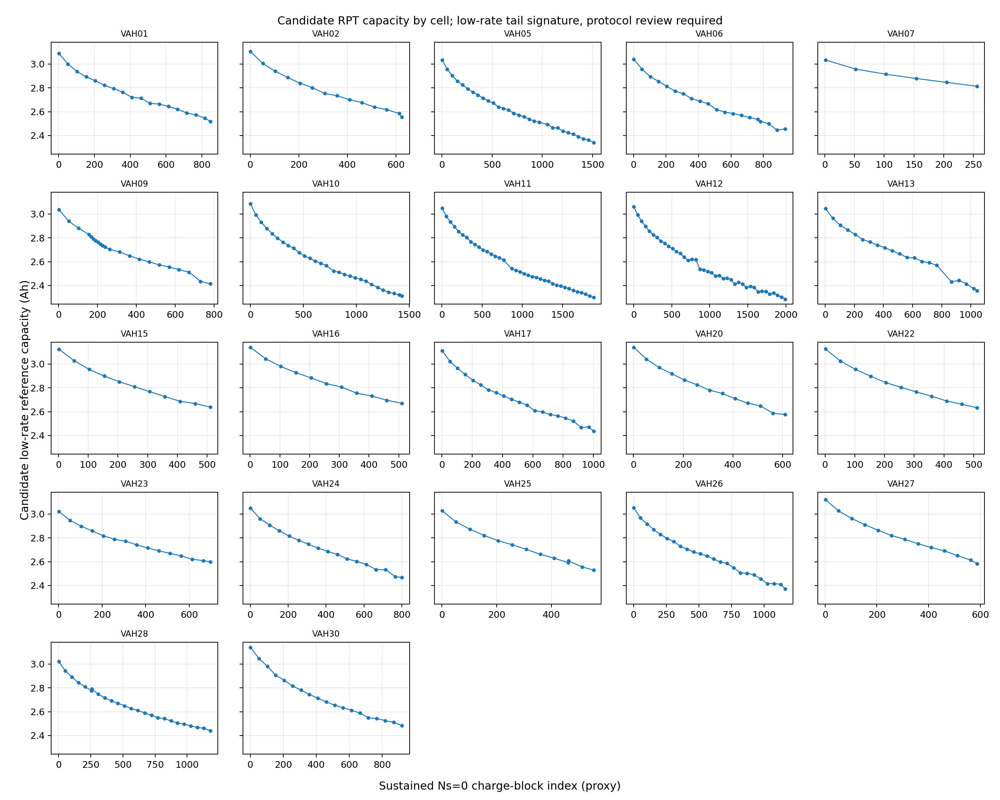
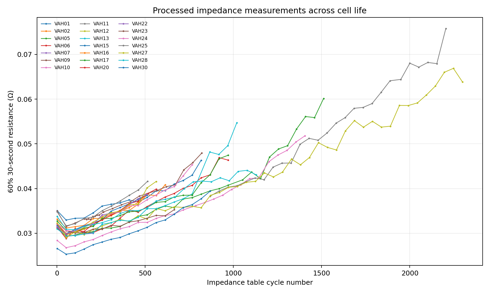

# 01. 数据审计

## 数据范围与结构

本地目录包含 22 个主文件 `VAHxx.csv` 和 21 个 `VAHxx_impedance.csv`；VAH26 没有阻抗文件。主表共有 15,309,317 行，列为 `time_s`、`Ecell_V`、`I_mA`、充放电能量与容量计数器、`Temperature__C`、原始 `cycleNumber` 和协议段 `Ns`。表头与 README 一致，审计未发现缺失或非数值字段。电芯为 Sony–Murata VTC6，数据来自实验室 eVTOL 任务循环，不是农业无人机现场飞行数据。

数据集论文报告 22 颗电芯、21,392 个循环；本地连续 `Ns=0` 充电块计数为 21,305（合并相邻同段后为 21,304），与论文数相差约 0.4%。README 明确指出 `cycleNumber` 是合并多个测试仪文件后的原始标签，不能直接作为全寿命索引。研究代码使用持续超过 100 秒的 `Ns=0` 块生成 `charge_cycle_index`，并将其明确视作顺序代理。

## 协议与工况

原始任务包含高功率起飞、低功率巡航、高功率着陆、静置及 CC–CV 充电。观测到的 `Ns=4/5/6` 分别对应三个放电阶段；全电芯阶段中位数约为 75 秒、800 秒、105 秒，平均电流约为 −14.8 A、−4.32 A、−16.75 A。协议变体包括巡航长度、放电功率、充电倍率、CV 截止电压和温度，详见根目录 README。阶段电流、温度和电压摘要见 [`active_phase_summary.csv`](../results/active_phase_summary.csv)。

## 容量测试与阻抗对照

候选低倍率容量测试按 `QDischarge≥1 Ah`、平均电流 −1.0 至 −0.3 A、持续至少 3000 秒、最低电压不高于 2.6 V 检出；较宽松的 1000 秒敏感性规则另行导出。严格规则得到 430 个候选，敏感性规则 444 个。候选与阻抗表不是一一对应：阻抗表共 388 行，按重建循环索引精确匹配 336 行，允许 ±1 个索引后匹配 369 行。缺失和偏移需结合测试仪异常记录人工核对，不能把自动候选数当作官方 RPT 数。

## 异常与质量限制

全数据有 310 个非正时间步、1 个超过 5 分钟的间隔；最大间隔为 VAH10 第 665,299 行的 25,238 秒。VAH27 第 23,721–23,799 行有 79 个静置电流为零的电压异常点，电压约 5.28–7.18 V；README 已记录该异常。温度高于 50 °C 的 81,439 行保留为工况数据，不能一概当作坏点。所有原始文件保持不变，异常行导出到 [`anomaly_rows.csv`](../results/anomaly_rows.csv)。README 中还记录 VAH05、VAH09、VAH10、VAH11、VAH13、VAH25、VAH27、VAH28 的测试异常，后续分析须屏蔽或分层说明。

来源：CMU [eVTOL Battery Dataset](https://kilthub.cmu.edu/articles/dataset/eVTOL_Battery_Dataset/14226830)；数据集论文 [Bills et al., Scientific Data (2023)](https://www.nature.com/articles/s41597-023-02180-5)。
