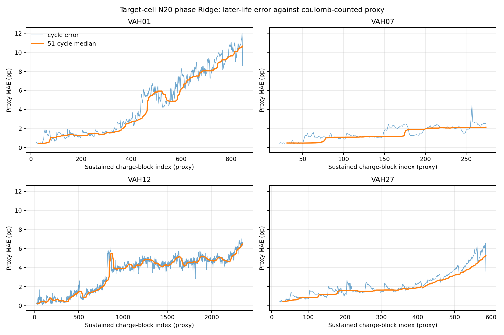

# 02. SOC 标签与基线

## 标签可用性

原始文件没有 SOC 列，也没有独立 BMS 或电化学 SOC 真值。`QDischarge_mA_h` 是测试仪的电量积分计数器，RPT 低倍率容量是可用容量锚点；二者可构造离线 SOC 代理，但不能据此报告真实 SOC 精度。任务放电终点仍有剩余容量，未被设为 SOC=0。

对每个任务阶段，先找到严格早于当前 `charge_cycle_index` 的最近候选 RPT 容量 (C_{prev})，再计算 `SOC_proxy = clip(1 − QDischarge_Ah / C_prev_Ah, 0, 1)`。不使用当前 RPT 的结果标注该测试，也不把未来 RPT 容量向前插值。此次保留了 20,855 个任务循环、62,563 个阶段末端标签；全部 62,563 个标签的容量锚点均严格早于当前循环，SOC 代理范围为 17.5%–92.3%。RPT 候选仍需人工复核，因此这些标签是暂定代理。

固定 3 Ah 分母相对最近已完成 RPT 的代理误差，在每颗电芯后期四分位中位数约 6.94 个百分点；22 颗电芯均随寿命上升。其方向是老化后固定 3 Ah 估计剩余 SOC 偏高。这是容量锚点变化带来的偏差，不是与独立 SOC 真值比较的误差。

## 阶段特征回归基线

已训练 `StandardScaler + Ridge(α=5)`，输入为阶段编号、持续时间、电流均值/峰值、电压最小/最大值和温度均值/最大值，不输入 `QDischarge` 或循环编号。按物理电芯做时间切分：目标电芯前 20 个任务循环用于初始化，后续循环用于测试；另做 21 电芯早期循环训练、单电芯留出，以及加上目标 N20 的比较。全程按电芯汇总，未随机拆分窗口。

| 方法 | 后期代理 MAE 中位数 | 较晚四分位代理 MAE 中位数 |
|---|---:|---:|
| 目标电芯 N20 Ridge | 2.52 pp | 4.36 pp |
| 其他电芯 N20 训练 | 3.47 pp | 4.92 pp |
| 其他电芯 + 目标 N20 | 3.45 pp | 4.55 pp |

目标电芯 N20 的后期 P95 循环 MAE 中位数为 5.16 pp。误差均相对于 `SOC_proxy`，不是实际 SOC。线性阶段基线没有证明电压模型能替代库仑计数器。

## 跨电芯 GRU

另训练一层 16 隐藏单元的因果 GRU，对按时间排序的阶段摘要建模；每段 12 个摘要（约四个三阶段任务），段边界重置隐状态。采用 5 折物理电芯留组、3 个随机种子；每折的标准化和权重只用未留出的 17–18 颗源电芯完整生命周期摘要，留出电芯仅评估其 N20 之后循环。源 GRU 后期代理 MAE 的电芯中位数为 1.18 pp，RMSE 中位数 1.65 pp，较晚四分位 MAE 中位数 1.38 pp。22 颗电芯中有 21 颗低于目标电芯 N20 Ridge；按电芯配对 Bootstrap，GRU 减 Ridge 的平均差为 −1.20 pp（95% 区间 −1.79 至 −0.45）。

以完全相同的 5 折和源生命周期标签训练 Ridge 对照，源全寿命 Ridge 的 MAE 中位数为 2.14 pp；源 GRU 的平均配对差为 −1.20 pp（95% 区间 −1.80 至 −0.68，20/22 颗电芯更低）。这说明此阶段摘要 GRU 对代理标签有跨电芯泛化信号，但不等于真实 SOC 估计更准。把目标 N20 再用于 GRU 仿射校正后，MAE 中位数反而升至 1.52 pp；按电芯平均差为 +0.04 pp（区间 −0.50 至 +0.42），没有观察到稳定收益。

本 GRU 使用阶段统计而非原始高频 V/I/T 序列，不是 FiberResearch 的 GRU/Head/SRA 完整复现；其源电芯使用全生命周期数据，优于只用源 N20 的 Ridge 比较也不能单独归因于网络结构。训练日志、留组权重、逐循环预测、配对统计和图分别见 [`gru_proxy_training_epochs.csv`](../logs/gru_proxy_training_epochs.csv)、[`models/`](../models/)、[`gru_proxy_crosscell_predictions.csv`](../results/gru_proxy_crosscell_predictions.csv)、[`gru_proxy_paired_comparison.csv`](../results/gru_proxy_paired_comparison.csv) 与 [`gru_ridge_proxy_comparison.png`](../figures/gru_ridge_proxy_comparison.png)。模型参数见 [`gru_proxy_crosscell_metadata.json`](../results/gru_proxy_crosscell_metadata.json)。

复现 Ridge：`python -B scripts/build_proxy_baselines.py`；复现 GRU：`python -B scripts/train_gru_proxy_crosscell.py`，随后运行 `python -B scripts/evaluate_source_ridge_full_crosscell.py` 和 `python -B scripts/analyze_gru_proxy_results.py`。

后续模型与维护实验只能称为“代理标签实验”，除非补充独立 SOC 参考曲线。
