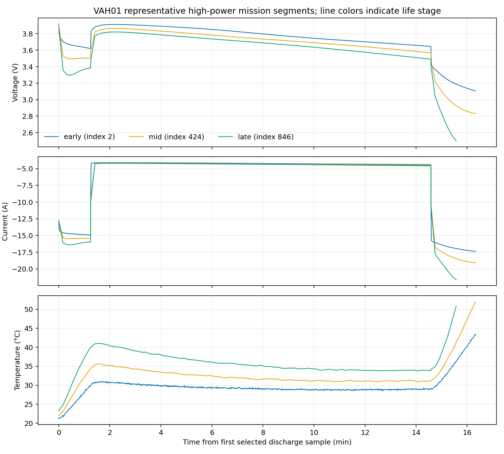

# 03. 生命周期漂移分析

## 容量与阻抗演化

按严格规则检出的 430 个低倍率 RPT 尾段候选覆盖 22 颗电芯。以每颗电芯首末候选值比较，容量代理中位变化为 −19.12%，范围 −7.29% 至 −25.30%；22 颗电芯的候选容量都没有超过 0.02 Ah 的反向上升步。这个趋势与老化一致，但候选规则和测试缺失会影响完整程度。

21 颗有阻抗文件的电芯共记录 388 次测量。60% SOC、30 秒指标在 20/21 颗电芯首末值之间上升，跨电芯中位增幅约 32.1%；VAH07 只有 5 次记录，末值略低于初值，样本不足以支持稳定反向老化结论。VAH26 没有阻抗数据。容量和阻抗曲线见 [`capacity_impedance_metrics.csv`](../results/capacity_impedance_metrics.csv)。

## 高功率响应与工况混杂

VAH01 的代表性任务曲线显示，起飞和着陆电流约 −15 A 与 −17 A，巡航约 −4.3 A；跨全电芯的巡航阶段最低电压在早晚寿命四分位间中位下降 0.113 V，21/22 颗电芯下降。温度与电流也随阶段和寿命变化，VAH09 是唯一呈轻微反向的电芯。该分析只基于阶段最低电压，未对温度、任务版本、真实 SOC 及负载偏差做匹配回归，因此只能作为“电压响应随生命周期变化”的证据，不能单独归因于老化或推断 SOC MAE。

## SOC 漂移解释

固定 3 Ah 估计与最近先验 RPT 容量代理之间的偏差由早期每电芯中位 0.97 pp 增至后期 6.94 pp，22/22 颗电芯上升。它说明固定名义容量会在寿命后段高估剩余 SOC，支持“容量衰退会改变电量—SOC 映射”的研究动机。由于代理标签本身使用同一电量积分和 RPT 容量，当前结果不等于对真实 SOC 漂移的无偏测量。

下一步应以时间/温度/电流条件化电压残差和独立 SOC 参考验证漂移预警；不能把单一电压趋势当成触发器结论。
